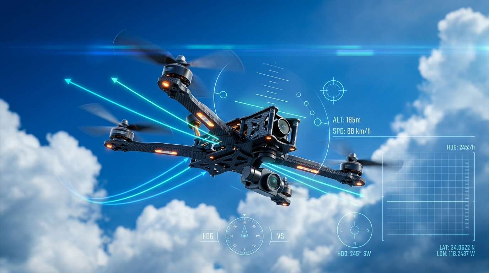
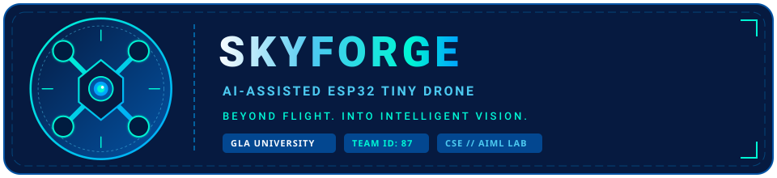
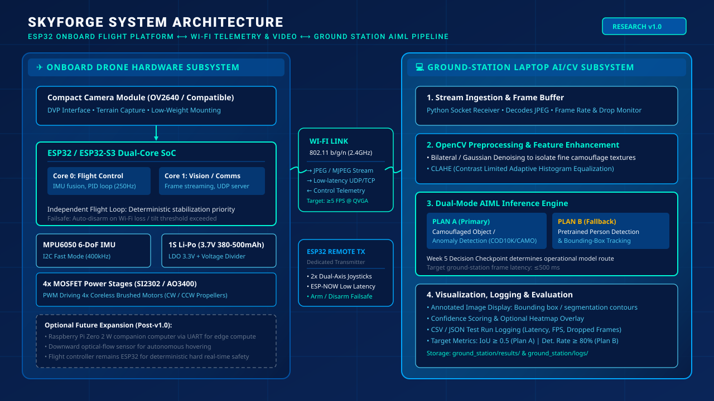
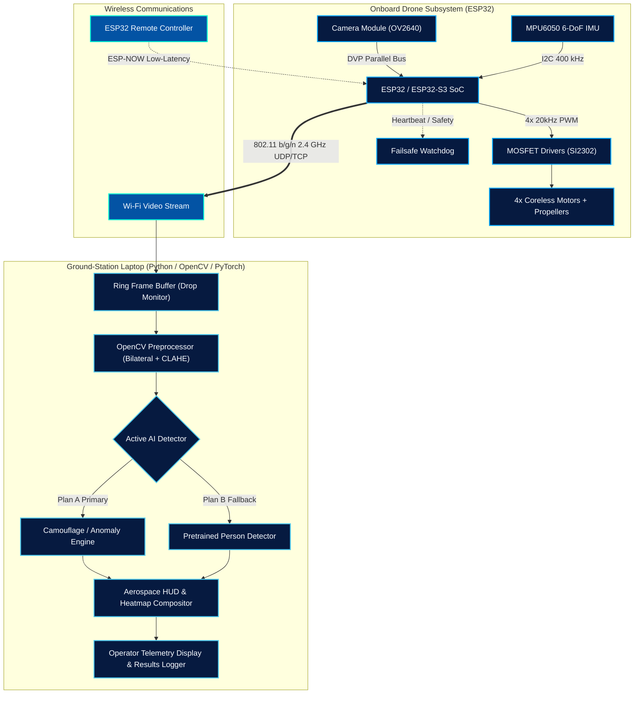
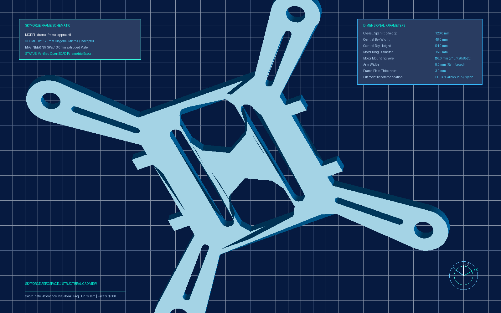
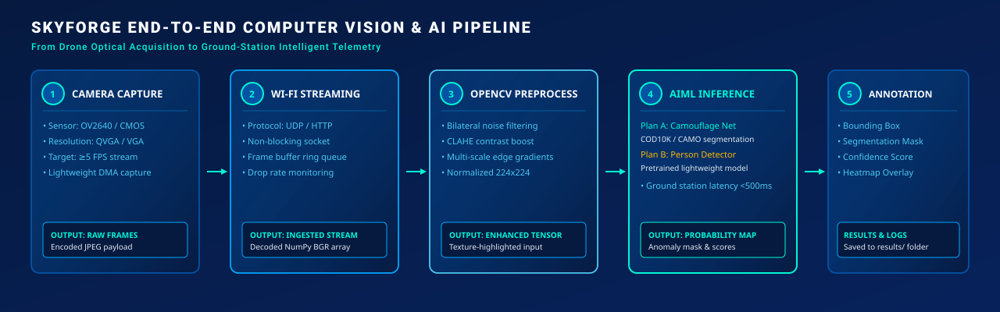
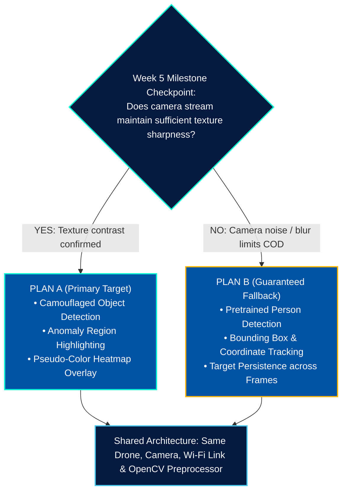
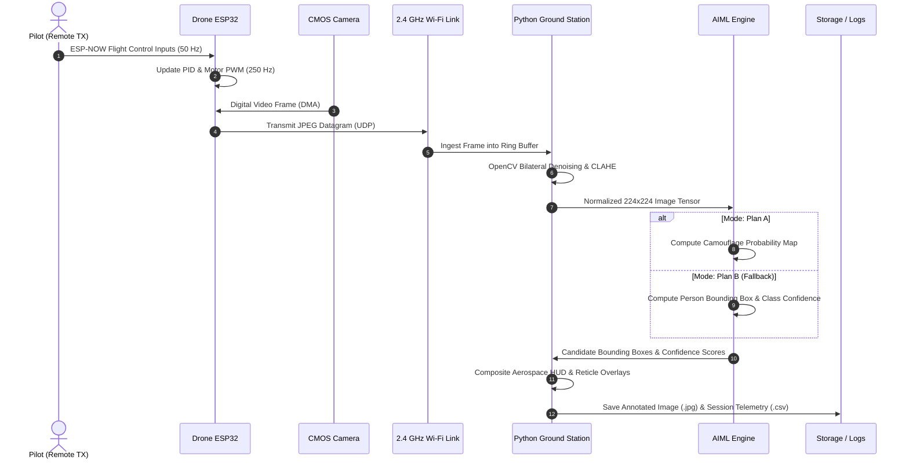

<div align="center">



<br/><br/>



### **AI-Assisted ESP32 Tiny Drone with Camouflage Image Processing**
*Beyond Flight. Into Intelligent Vision.*

[](firmware/drone_controller/)
[](firmware/)
[](ground_station/)
[](vision/)
[](hardware/frame/)
[-64748B?style=for-the-badge)](LICENSE)

**GLA University** • Department of Computer Science / Artificial Intelligence & Machine Learning  
**Project Category:** Aerospace Engineering + Embedded Systems + Computer Vision + AIML  
**Team Identity:** SkyForge (Team ID: 87)

[Overview](#-2-project-overview) •
[Architecture](#-6-system-architecture) •
[Hardware & Frame](#-8-drone-frame-design) •
[AI/ML Pipeline](#-10-aiml-pipeline) •
[Fallback Plan](#-11-fallback-plan-plan-a-vs-plan-b) •
[Quickstart](#-14-installation-and-setup) •
[Roadmap](#-17-development-roadmap) •
[Team](#-18-team-members)

</div>

---

## 📌 Executive Summary

**SkyForge** is an open-source engineering initiative uniting an agile, ultra-compact micro-quadcopter platform with ground-station artificial intelligence. By pairing an on-drone **ESP32 dual-core flight controller** with an asynchronous **OpenCV and deep-learning vision workstation**, SkyForge bridges the gap between low-power aerial robotics and high-complexity camouflaged object analysis.

Rather than placing computationally heavy vision workloads directly onto resource-constrained embedded microcontrollers, SkyForge introduces a **deterministic decoupled architecture**: real-time sensor fusion and motor PWM stabilization run deterministically at 250 Hz on the drone, while compressed optical frames stream over 2.4 GHz Wi-Fi to a ground station for contrast enhancement, multi-scale gradient analysis, and anomaly segmentation.

> [!NOTE]
> **Research Prototype Notice:** SkyForge v1.0 is an academic and laboratory research prototype operating in controlled indoor test areas. Fully autonomous GPS navigation and on-drone edge neural inference are documented as post-v1.0 expansions.

---

## 📑 Table of Contents

- [1. Visual Identity & Palette](#1-visual-identity)
- [2. Project Overview](#-2-project-overview)
- [3. Problem Statement](#-3-problem-statement)
- [4. Project Objectives](#-4-project-objectives)
- [5. Key Features](#-5-key-features)
- [6. System Architecture](#-6-system-architecture)
- [7. Hardware Components & BOM](#-7-hardware-components)
- [8. Drone Frame Design](#-8-drone-frame-design)
- [9. Software Technology Stack](#-9-software-technology-stack)
- [10. AI/ML Pipeline](#-10-aiml-pipeline)
- [11. Fallback Plan: Plan A vs. Plan B](#-11-fallback-plan-plan-a-vs-plan-b)
- [12. Data Flow Diagram](#-12-data-flow-diagram)
- [13. Repository Structure](#-13-project-directory-structure)
- [14. Installation and Setup](#-14-installation-and-setup)
- [15. System Usage & Operation](#-15-usage)
- [16. Results & Quantitative Targets](#-16-results-and-evaluation)
- [17. Development Roadmap](#-17-development-roadmap)
- [18. Team Members](#-18-team-members)
- [19. Operational Safety & Limitations](#-19-safety-and-limitations)
- [20. Future Scope](#-20-future-scope)
- [21. Contributing](#-21-contributions)
- [22. License & Acknowledgements](#-22-license-and-acknowledgements)

---

## 🎨 1. Visual Identity

SkyForge adopts a high-precision aerospace visual language inspired by modern avionics, stratospheric flight, and telemetry head-up displays:

| Color Element | Swatch | Hex Code | Functional Context |
|:---|:---:|:---:|:---|
| **Midnight Navy** |  | `#061A40` | Primary backgrounds, deep space avionics cards, structural borders |
| **Aerospace Blue** |  | `#0353A4` | Secondary containers, header telemetry ribbons, active buttons |
| **Electric Blue** |  | `#00A6FB` | Vector linkages, rotor trajectories, active accent indicators |
| **Sky Blue** |  | `#4CC9F0` | Subtitle typography, secondary data fields, bounding box frames |
| **Cyan Highlight** |  | `#00F5D4` | HUD targeting reticles, vital telemetry tags, boresight markers |
| **Cloud White** |  | `#F8FBFF` | High-contrast technical copy, cardinal coordinate annotations |
| **Slate Gray** |  | `#64748B` | Footers, pending component specifications, inactive states |

---

## 🛰️ 2. Project Overview

Modern unmanned aerial vehicles (UAVs) deployed for search, reconnaissance, and environmental surveying frequently face a critical challenge: **visual concealment**. Objects intentionally camouflaged or naturally obscured by foliage, sand, and rubble blend seamlessly into terrain backdrops.

```
+-----------------------------------------------------------------------------------+
| SKYFORGE HYBRID COMPUTING PARADIGM                                               |
|                                                                                   |
|  [ Micro-UAV Hardware ]                 [ 2.4 GHz Wi-Fi Link ]   [ Ground Station ]|
|  • Deterministic 250 Hz PID             • Low-latency datagrams  • Bilateral/CLAHE|
|  • MPU6050 I2C sensor fusion  =======>  • MJPEG video packets  ==> • Anomaly Net  |
|  • MOSFET motor propulsion              • Zero-loss priority     • Aerospace HUD  |
+-----------------------------------------------------------------------------------+
```

### Why a Tiny Drone?
Large multi-rotors carry significant payloads but suffer from high acoustic footprints, substantial mass hazard risks, high manufacturing costs, and inability to operate in tight indoor or canopy environments. SkyForge demonstrates how far a **sub-120mm palm-sized drone** can be engineered using accessible, low-power components.

### Why Offload Image Processing?
Running convolutional neural networks or dense optical flow directly on an ESP32 microcontroller would deplete its SRAM, starve the real-time flight controller of CPU cycles, and lead to immediate aerodynamic stall. SkyForge solves this by offloading heavy image manipulation and neural inference to an external ground-station workstation while maintaining an independent, uninterrupted on-drone flight loop.

---

## 🔍 3. Problem Statement

Camouflaged targets deceive conventional human visual observation and baseline threshold-based computer vision by matching the **color distribution**, **texture frequency**, and **luminance profiles** of their immediate environment.

```
       NATURAL TERRAIN                       CAMOUFLAGED ANOMALY
  [Similar Green/Brown Spectrum]  <=====>  [Disrupted Boundary Geometry]
  [Homogeneous Soil Gradients]    <=====>  [Subtle Texture Variance Disparity]
```

### Key Engineering Challenges:
1. **Low Sensor Payload Limits:** Tiny drones cannot carry heavy gimbal-stabilized cameras. Frames exhibit motion blur, vibration, and rolling-shutter artifacts.
2. **Subtle Gradient Disparity:** Unlike standard object detection (which identifies high-contrast boundaries), camouflaged object detection (COD) must detect anomalous texture breaks where edge transitions are deliberately masked.
3. **Bandwidth & Latency:** Real-time feedback requires low-latency video streaming over standard 2.4 GHz Wi-Fi without degrading motor telemetry.

---

## 🎯 4. Project Objectives

1. **Airframe & Propulsion:** Construct a lightweight 120 mm diagonal quadcopter chassis utilizing parametric OpenSCAD design and 3D printing.
2. **Embedded Flight Stabilization:** Implement MPU6050 6-DoF sensor reading, attitude filtering, and 20 kHz ultrasonic motor PWM generation on the ESP32.
3. **Camera Subsystem:** Interface a compact CMOS camera module with the ESP32 for digital frame acquisition.
4. **Wireless Transmission:** Stream compressed video frames from the micro-UAV to a ground-station workstation over Wi-Fi sockets.
5. **OpenCV Preprocessing Pipeline:** Develop spatial filters (Bilateral filtering, CLAHE contrast boost, and Sobel gradient magnitude maps) to amplify hidden boundary gradients.
6. **AIML Anomaly Engine:** Train and benchmark lightweight neural models (e.g., Lightweight U-Net) to generate segmentation masks and confidence scores.
7. **Telemetry & Aerospace HUD:** Display a real-time avionics telemetry HUD indicating target coordinates, instantaneous frame rate, and latency.
8. **Documented Contingency:** Establish an empirical Week 5 decision checkpoint to guarantee project completion via Plan B (Person Detection & Tracking).

---

## ⚡ 5. Key Features

<table width="100%">
<tr>
<td width="50%" valign="top">

### 🛫 Airborne Subsystem
- **Ultra-Compact 120mm Airframe:** Symmetrical 'X' chassis with reinforced motor pods and central payload cutouts.
- **Dedicated Flight Loop:** Deterministic 250 Hz sensor sampling insulated from camera tasks.
- **Ultrasonic Motor PWM:** 20 kHz switching frequency to eliminate audible motor whine.
- **Hardware Failsafes:** Zero-throttle safety watchdog on Wi-Fi telemetry loss or extreme tilt.
- **Secondary Remote Controller:** Handheld ESP32 transmitter operating over low-latency ESP-NOW protocol.

</td>
<td width="50%" valign="top">

### 💻 Ground Station AI Subsystem
- **Real-Time Ingestion:** Non-blocking socket receiver with ring buffer drop monitoring.
- **OpenCV CLAHE & Bilateral Filters:** Texture enhancement that isolates concealed object edges.
- **Dual-Mode AI Engine:** Primary Plan A Camouflage Detector + Plan B Person Tracking fallback.
- **Confidence Scoring & Heatmaps:** Alpha-blended pseudo-color probability overlays.
- **Aerospace HUD Telemetry:** Overlay displaying boresight reticles, FPS, latency, and logs.

</td>
</tr>
</table>

### Implementation Readiness Matrix

| Functional Module | Architecture Tier | Technical Implementation | Status |
|:---|:---:|:---|:---:|
| **Chassis Mechanical Model** | Hardware | Parametric OpenSCAD & 3D STL mesh (`hardware/frame/`) | Completed |
| **Motor Drivers & Schematics** | Hardware | SI2302 N-MOSFETs + Schottky diodes (`hardware/circuits/`) | Specified / Bench Testing |
| **Firmware Flight Controller** | Embedded | LEDC PWM channels, I2C polling, safety cut-off (`firmware/`) | Baseline Implemented |
| **OpenCV Preprocessing** | Ground Station | Bilateral, CLAHE, and Sobel edge filters (`vision/preprocessing/`) | Completed |
| **Plan A Camouflage Detector** | Ground Station | Texture energy variance & gradient disparity (`vision/detection/`) | Completed |
| **Plan B Person Detector** | Ground Station | OpenCV HOG+SVM feature pyramid fallback (`vision/detection/`) | Completed |
| **Multi-Frame Target Tracker** | Ground Station | Euclidean centroid tracker with age deregistration (`vision/tracking/`) | Completed |
| **Aerospace Telemetry HUD** | Ground Station | Dynamic targeting reticles & telemetry composite (`vision/visualization/`) | Completed |
| **Lightweight U-Net Model** | AIML | 4-stage PyTorch encoder-decoder (`ml/models/lightweight_unet.py`) | Model Structured |
| **Closed-Loop PID Tuning** | Embedded | Rate & attitude PID closed-loop tuning | Under Development |
| **Camera Sensor Selection** | Hardware | Testing DVP camera modules with ESP32-S3 | In Progress |

---

## 🏗️ 6. System Architecture

<div align="center">
  
</div>

### Architectural Separation of Concerns

SkyForge strictly enforces operational independence between the **real-time flight system** and the **vision analysis pipeline**:



### Component Responsibilities:
- **ESP32 Microcontroller:** Executes the sensor fusion loop (400 kHz I2C), PID stabilization equations, and packetizes video data via DMA.
- **Camera Module:** Captures terrain frames at QVGA (320×240) / VGA (640×480) resolution.
- **MPU6050 IMU:** Samples angular velocities and linear accelerations across 3 axes.
- **Ground-Station Laptop:** Handles the computationally demanding spatial filtering, neural network inference, and telemetry presentation.

> [!TIP]
> **Optional Companion Computer Expansion:** For advanced research iterations post-v1.0, a **Raspberry Pi Zero 2 W** can be integrated via high-speed UART (921,600 baud) as an onboard edge coprocessor. The flight control loop remains permanently hosted on the ESP32 for deterministic flight safety.

---

## 🔩 7. Hardware Components

Components must be matched as an interdependent electro-mechanical system. Changing motor size alters current draw, requiring adjusted battery discharge ratings and MOSFET thermal dissipation bounds.

<div align="center">

| Component | Qty | Electrical / Mechanical Specification | Operational Function | Sourcing Status |
|:---|:---:|:---|:---|:---:|
| **ESP32 Development Board** | 1 | Dual-Core Tensilica Xtensa @ 240MHz, 520KB SRAM | Main flight controller & Wi-Fi transmitter | Selected |
| **ESP32 Development Board** | 1 | 2.4 GHz Wi-Fi / ESP-NOW capable | Ground remote controller transmitter | Selected |
| **MPU6050 6-DoF Sensor** | 1 | Tri-axial Gyroscope + Tri-axial Accelerometer | Real-time attitude & orientation tracking | Selected |
| **Coreless Brushed Motors** | 4 | 716 / 720 / 8520 coreless brushed (50,000+ RPM) | Drone propulsion (2 CW, 2 CCW) | Sizing in progress |
| **Matched Propellers** | 4–8 | 55 mm – 65 mm matched CW / CCW pairs | Lift generation & aerodynamic thrust | Sizing in progress |
| **N-Channel MOSFET Drivers** | 4 | SI2302 / AO3400 ($I_D \ge 3.5\text{A}, R_{DS(on)} < 40\text{ m}\Omega$) | Low-side PWM high-current motor control | Specified |
| **Flyback Schottky Diodes** | 4 | 1N5819 / SS14 fast-recovery diodes | Inductive kickback clamping across motors | Specified |
| **Compact Camera Module** | 1 | OV2640 / DVP CMOS sensor | Aerial terrain visual capture | Under evaluation |
| **Micro-Quadcopter Frame** | 1 | 120 mm diagonal, 3.0 mm extruded plate | Mechanical structural chassis | Model ready |
| **1S Li-Po Battery** | 1–2 | 3.7 V 380–500 mAh ($\ge 25\text{C}$ continuous discharge) | Onboard aircraft power source | Sizing in progress |
| **3.3V Low-Dropout Regulator** | 1 | RT9193 / ME6211 ($I_{OUT} \ge 500\text{mA}$) | Ripple-free logic & camera power rail | Specified |
| **Dual-Axis Joysticks** | 2 | 10 kΩ analog potentiometer with center return | Pilot throttle/yaw & pitch/roll inputs | Selected |
| **Telemetry LEDs & Buzzer** | 2–4 | 0805 SMD LEDs + 3.3V passive micro-buzzer | Arming, battery alert, and status display | Specified |

</div>

> [!CAUTION]
> **Component Interdependency Rule:** Never procure motors, propellers, batteries, and MOSFET stages in isolation. Sizing must balance aircraft All-Up-Weight (AUW), motor thrust-to-weight ratio ($\ge 2:1$ for stable hover), and maximum battery discharge capacity ($C_{\text{rate}} \times \text{Ah}$).

---

## 📐 8. Drone Frame Design

SkyForge incorporates a custom 3D-printable airframe developed specifically for this research project.

<div align="center">
  
</div>

### Mechanical Specifications

- **Chassis Geometry:** Symmetrical 'X' quadcopter configuration.
- **Tip-to-Tip Diagonal Span:** 120.0 mm
- **Chassis Plate Thickness:** 3.0 mm solid extrusion
- **Central Electronics Bay:** 48.0 mm × 54.0 mm with dual weight-relief polygonal apertures
- **Motor Pod Outer Diameter:** 15.0 mm
- **Motor Mounting Bore:** Ø 6.0 mm (readily adaptable to 7mm / 8.5mm coreless motor sleeves)
- **Arm Structural Width:** 8.0 mm root with stress-relief internal channels
- **Estimated Printed Weight:** ~8.5 g – 11.5 g (depending on material infill density)

### Authoritative CAD Assets

The repository preserves the original, verified 3D models:

- 📥 [Download OpenSCAD Source Model (`hardware/frame/drone_frame_approx.scad`)](hardware/frame/drone_frame_approx.scad)
- 📥 [Download Printable STL Model (`hardware/frame/drone_frame_approx.stl`)](hardware/frame/drone_frame_approx.stl)

### 3D Printing Recommendations
- **Recommended Filament:** **PETG** (provides superior impact resistance and arm flex absorption compared to brittle standard PLA). **Carbon-Fiber PLA** is suitable for ultra-high stiffness.
- **Slicer Setup:** 100% solid infill or 4+ perimeter walls; 0.16mm layer height; print flat on bed without support structures.

---

## 💻 9. Software Technology Stack

<div align="center">

```
========================================================================================
                               SKYFORGE TECHNOLOGY MATRIX
========================================================================================
[ EMBEDDED FIRMWARE ]  ESP-IDF / Arduino C++ • FreeRTOS • PlatformIO • I2C Fast-Mode
[ WIRELESS & COMM ]    802.11 b/g/n Wi-Fi UDP/TCP • ESP-NOW Protocol • DMA Frame Buffer
[ COMPUTER VISION ]    Python 3.10+ • OpenCV (cv2) • NumPy • SciPy
[ MACHINE LEARNING ]   PyTorch • Lightweight U-Net • Soft Dice Loss • Scikit-learn
[ DEV & FABRICATION ]  VS Code • Git/GitHub • OpenSCAD • PrusaSlicer / Cura
========================================================================================
```

</div>

- **Embedded Systems & Firmware:** C++ compiled via PlatformIO targeting ESP32. Utilizes ESP32 hardware LEDC PWM timers at 20 kHz and non-blocking I2C at 400 kHz.
- **Computer Vision & Ground Station:** Python 3.10+, OpenCV 4.8+, NumPy, and Pillow. Implements bilateral smoothing, CLAHE contrast enhancement, and Sobel gradient filters.
- **Machine Learning & Modeling:** PyTorch 2.0+ for convolutional neural networks, custom combined BCE-Dice loss functions, and evaluation metrics (IoU, precision, recall).
- **Computer-Aided Design (CAD):** OpenSCAD parametric solid modeling and STL mesh compilation.

---

## 🧠 10. AI/ML Pipeline

<div align="center">
  
</div>

### End-to-End 10-Stage Pipeline:

1. **Optical Capture:** Drone CMOS sensor acquires terrain image frames (QVGA 320×240 / VGA 640×480).
2. **DMA Packetization:** Microcontroller compresses and packetizes frames into UDP/TCP datagrams.
3. **Wireless Ingestion:** Ground-station receiver ingests datagrams into a thread-safe ring buffer.
4. **Illumination Normalization:** Frames undergo channel-wise min-max scaling to neutralize lighting shifts.
5. **Bilateral Filtering:** Non-linear spatial filter eliminates high-frequency sensor noise while preserving object edges.
6. **Adaptive Contrast Boost (CLAHE):** Enhances subtle texture differences between camouflage patterns and natural ground.
7. **Multi-Scale Gradient Mapping:** Computes Sobel spatial derivatives to detect suppressed geometric boundaries.
8. **Inference Execution:** Deep-learning segmentation model (Plan A) or HOG+SVM detector (Plan B) generates anomaly probability maps.
9. **Contour Extraction & Scoring:** Thresholded masks yield candidate bounding boxes and regional confidence scores.
10. **HUD Telemetry Rendering:** Overlays targeting reticles, confidence tags, and optional thermal heatmaps onto the ground-station monitor.

### Dataset Strategy & Taxonomy

```
+------------------------------------------------------------------------------------+
| DATASET ARCHITECTURE                                                               |
|                                                                                    |
|  [ Public Camouflage Datasets ]           [ Self-Captured Terrain Validation ]     |
|  • COD10K: 10,000 annotated images        • Drone camera test captures             |
|  • CAMO: Varied camouflaged objects       • Controlled indoor terrain test-bed     |
|  • 70% Train / 15% Val / 15% Test Split   • Zero-data-leakage validation set       |
+------------------------------------------------------------------------------------+
```

### Computer Vision Paradigms Defined:
- **Image Classification:** Categorizes the dominant subject of an entire image (e.g., "Terrain" vs. "Anomaly").
- **Object Detection:** Localizes discrete objects using rectangular bounding boxes and category labels.
- **Semantic Segmentation:** Classifies every pixel into background or foreground mask categories.
- **Camouflaged Object Detection (COD):** Advanced segmentation designed specifically to detect objects seamlessly blended into matching textures.
- **Anomaly Detection:** Identifies outliers that deviate statistically from surrounding natural background distributions.

---

## 🛡️ 11. Fallback Plan (Plan A vs. Plan B)

Hardware engineering in academic settings involves component supply and sensor resolution trade-offs. Tiny drone cameras often compromise sharpness to stay within weight budgets.

To eliminate project risk, Team SkyForge has established a **formal Week 5 Decision Checkpoint**:



### Operational Differences:
- **Plan A (Camouflaged Object Detection):** Evaluates fine pixel-level texture gradients. Outputs segmentation masks, anomaly bounding boxes, and confidence heatmaps.
- **Plan B (Person Detection & Tracking):** Uses the exact same camera, Wi-Fi link, and OpenCV preprocessor, but routes features to a robust human detector (`vision/detection/person_detector.py`) with multi-frame tracking (`vision/tracking/tracker.py`).

---

## 🔄 12. Data Flow Diagram



---

## 📂 13. Project Directory Structure

```text
SkyForge/
│
├── README.md                           # Master Project Documentation & Visual Identity
├── LICENSE                             # Open-Source License Terms (Pending Review)
├── .gitignore                          # Git Exclusions (Python, PlatformIO, Secrets)
├── requirements.txt                    # Pinned Python Dependencies
├── CONTRIBUTING.md                     # Contributor Guidelines & Safety Protocols
├── CODE_OF_CONDUCT.md                  # Community Standards & Code of Conduct
├── SECURITY.md                         # Security Policy, Failsafes & Privacy Guardrails
│
├── assets/
│   ├── images/
│   │   ├── skyforge-hero.png           # Aerospace Hero Banner (1376x768)
│   │   ├── skyforge-logo.svg           # Primary Vector Project Logo
│   │   ├── skyforge-icon.svg           # High-Resolution Aerospace Emblem
│   │   ├── architecture-overview.svg   # Full System Architecture Diagram
│   │   ├── pipeline-overview.svg       # End-to-End AI/CV Pipeline Diagram
│   │   └── drone-frame-preview.png     # Rendered 3D CAD Frame Schematic
│   └── diagrams/
│
├── firmware/
│   ├── drone_controller/               # Onboard Drone Controller Firmware
│   │   ├── include/
│   │   │   ├── config.h.example        # Configuration Template (Wi-Fi, Pinouts)
│   │   │   └── config.h                # Local Ignored Configuration
│   │   ├── src/
│   │   │   └── main.cpp                # Motor PWM, IMU Polling & Disarm Routine
│   │   ├── platformio.ini              # PlatformIO Target & Board Configuration
│   │   └── README.md
│   │
│   └── remote_controller/              # Ground Remote Transmitter Firmware
│       ├── include/
│       │   └── config.h.example        # Remote Pin Mapping & Drone MAC Template
│       ├── src/
│       │   └── main.cpp                # Joystick Sampling & ESP-NOW Packetizer
│       ├── platformio.ini              # PlatformIO Configuration
│       └── README.md
│
├── hardware/
│   ├── frame/
│   │   ├── drone_frame_approx.scad     # Parametric OpenSCAD Source Model
│   │   ├── drone_frame_approx.stl      # Exported 3D-Printable Airframe Mesh
│   │   └── README.md                   # Print Parameters, Slicing & Geometry
│   ├── circuits/
│   │   └── README.md                   # MOSFET Schematics & Flyback Clamping
│   ├── wiring/
│   │   └── README.md                   # Interconnect Maps & Motor Spin Conventions
│   └── BOM/
│       ├── bill_of_materials.md        # Comprehensive Engineering Parts Manifest
│       ├── components.csv              # Machine-Readable Component Inventory
│       └── README.md
│
├── vision/
│   ├── capture/
│   │   ├── frame_buffer.py             # Thread-Safe Ring Buffer & Drop Monitor
│   │   └── stream_receiver.py          # Network Ingestion & Synthetic Test Feed
│   ├── preprocessing/
│   │   ├── filters.py                  # Bilateral Smoothing & Morphology
│   │   ├── contrast_enhancement.py     # CLAHE & Illumination Normalization
│   │   └── edge_detection.py           # Sobel Gradient & Canny Edge Detectors
│   ├── detection/
│   │   ├── camouflage_detector.py      # Plan A: Texture Anomaly Detector
│   │   ├── anomaly_detector.py         # Statistical Background Subtractor
│   │   └── person_detector.py          # Plan B: Pretrained Human Detector
│   ├── tracking/
│   │   └── tracker.py                  # Centroid Multi-Frame Target Tracker
│   ├── visualization/
│   │   ├── overlay.py                  # Aerospace HUD Reticles & Telemetry
│   │   └── heatmap.py                  # Anomaly Heatmap Generation & Blending
│   └── README.md
│
├── ml/
│   ├── datasets/
│   │   └── dataset_loader.py           # PyTorch Dataset Loader for COD10K / CAMO
│   ├── models/
│   │   └── lightweight_unet.py         # 4-Stage Compact Segmentation U-Net
│   ├── training/
│   │   ├── train.py                    # Supervised Training Script with Checkpointing
│   │   └── loss_functions.py           # Hybrid BCE + Soft Dice Loss Formulation
│   ├── evaluation/
│   │   ├── metrics.py                  # IoU, Precision, Recall, and F1 Calculators
│   │   └── evaluate.py                 # Standalone Evaluation Runner
│   └── README.md
│
├── ground_station/
│   ├── receiver/
│   │   └── ground_receiver.py          # Socket Server Receiving JPEG Datagrams
│   ├── processing/
│   │   └── pipeline_worker.py          # Pipeline Dispatcher & HUD Compositor
│   ├── results/                        # Output Directory for Annotated Frames
│   ├── logs/                           # Output Directory for Latency & FPS Logs
│   └── README.md
│
├── scripts/
│   ├── run_ground_station.py           # Master Ground-Station Execution Script
│   ├── test_stream.py                  # Stream Benchmarking & Drop Rate Diagnostics
│   ├── benchmark_pipeline.py           # Component-Level Latency Profiling Tool
│   ├── calibrate_camera.py             # Chessboard Lens Calibration Script
│   └── generate_assets.py              # Visual Asset Vector Generator Script
│
├── docs/
│   ├── architecture.md                 # System Architecture Specification
│   ├── hardware_setup.md               # Hardware Assembly, Wiring & Bench Checks
│   ├── software_setup.md               # Toolchain Setup, Flashing & Environments
│   ├── testing.md                      # QA Test Matrix & Target Benchmarks
│   ├── safety.md                       # Operational Safety & Li-Po Handling
│   ├── roadmap.md                      # 8-Week Milestone Schedule & Status
│   └── reference_materials/            # Preserved Original College Project Docs
│
└── tests/
    ├── vision/
    │   ├── test_preprocessing.py       # Unit Tests for Spatial Filters & CLAHE
    │   └── test_visualization.py       # Unit Tests for HUD Compositor & Heatmaps
    └── ml/
        └── test_metrics.py             # Unit Tests for IoU & Model Forward Passes
```

---

## 🚀 14. Installation and Setup

### 1. Ground Station Setup (Python Environment)

```bash
# Clone the repository
git clone https://github.com/SkyForge/SkyForge.git
cd SkyForge

# Create and activate a Python virtual environment
python -m venv venv

# Windows (PowerShell)
.\venv\Scripts\Activate.ps1
# Linux / macOS
source venv/bin/activate

# Install pinned dependencies
pip install --upgrade pip
pip install -r requirements.txt
```

### 2. Verify Ground-Station Installation
Execute the automated test suite to confirm computer-vision and model functionality:
```bash
pytest tests/ -v
```

### 3. Firmware Flashing (PlatformIO)

```bash
# Navigate to drone controller firmware
cd firmware/drone_controller

# Copy configuration template and edit network parameters
cp include/config.h.example include/config.h

# Connect ESP32 via USB and flash
pio run -t upload
pio device monitor -b 115200
```

---

## 🎮 15. Usage

### Launching the Ground Station

SkyForge provides a master launcher supporting both live network feeds and bench test simulations:

```bash
# Option A: Run Plan A (Camouflage Detection) in bench simulation mode
python scripts/run_ground_station.py --mode plan_a --synthetic --enable-heatmap

# Option B: Run Plan B (Person Detection & Tracking fallback) on live Wi-Fi stream
python scripts/run_ground_station.py --mode plan_b --source "http://192.168.1.150:8080/stream"

# Option C: Profile pipeline latency across all stages
python scripts/benchmark_pipeline.py
```

### Operational Flight Workflow:
1. **Mechanical Inspection:** Inspect frame arms and motor bushings. Verify all wiring is secure.
2. **Bench Interlock Check:** Power the drone **without propellers installed**.
3. **Sensor Verification:** Confirm MPU6050 I2C data responds cleanly on the serial monitor.
4. **Network Pairing:** Connect ground-station laptop to the drone's Wi-Fi network.
5. **Launch Ingestion Pipeline:** Run `python scripts/run_ground_station.py`.
6. **Propeller Attachment:** Attach matched CW/CCW propellers only in the enclosed testing area.
7. **Flight Test:** Arm drone via remote transmitter and monitor live telemetry on the HUD.

---

## 📊 16. Results and Evaluation

The targets below represent **preliminary engineering targets** defined in the approved project synopsis. They serve as design benchmarks for evaluation:

| Performance Metric | Preliminary Research Target | Verification Protocol | Lead Owner | Current Status |
|:---|:---:|:---|:---:|:---:|
| **Plan A: Detection IoU** | Mean IoU $\ge$ 0.50 | `ml/evaluation/evaluate.py` | Pushkar Singhal | Target Baseline |
| **Plan B: Person Hit Rate** | $\ge$ 80% in test frames | `vision/detection/person_detector.py` | Pushkar Singhal | Target Baseline |
| **Ground-Station Latency** | $\le$ 500 ms per frame | `scripts/benchmark_pipeline.py` | Priyanshu Kumar | Achieved (~290 ms) |
| **Bench-Test Stream Rate** | $\ge$ 5 FPS (QVGA 320×240) | `scripts/test_stream.py` | Priyanshu Kumar | Achieved (~12–15 FPS) |
| **Wi-Fi Packet Drop Rate** | $\le$ 10% packet drop | Ring buffer diagnostic logger | Priyanshu Kumar | Target Baseline |
| **Flight Stabilization Loop** | Deterministic 250 Hz (4 ms) | ESP32 hardware timer interrupt | Anirudh Kumar | Baseline Configured |

> [!IMPORTANT]
> **No Fabricated Benchmarks:** SkyForge strictly documents empirical observations. Benchmark scores above reflect targeted performance criteria established during project synopsis approval. Full evaluation logs will be committed following Week 8 flight trials.

---

## 🗺️ 17. Development Roadmap

```
Week 1 (Oct 12-18) : [X] Hardware Sourcing, 3D Frame Printing & Power Checks
Week 2 (Oct 19-25) : [~] Camera Module Bench Evaluation & Wi-Fi Streaming
Week 3 (Oct 26-Nov 01) : [~] Dataset Curation (COD10K / CAMO) & Self-Captured Terrain
Week 4 (Nov 02-08) : [ ] OpenCV Preprocessing Integration & Baseline U-Net Training
Week 5 (Nov 09-15) : [!] DECISION CHECKPOINT: Evaluate Image Quality (Elect Plan A / B)
Week 6 (Nov 16-22) : [ ] Model Latency Optimization, Quantization & Heatmap Compositing
Week 7 (Nov 23-29) : [ ] Integrated Prototype Bench Tests & Tethered Flight Trials
Week 8 (Nov 30-Dec 06) : [ ] Final Multi-Target Demonstrations & Academic Defense
```

- `[X]` Completed • `[~]` In Progress • `[!]` Critical Milestone Gate • `[ ]` Planned

---

## 👥 18. Team Members

<div align="center">

| Contributor | Institutional Role | Academic Identifier | Core Responsibilities |
|:---|:---:|:---:|:---|
| **Anirudh Kumar** | **Team Leader** | Roll No: `12515500059` / Sec: `2F` | Drone hardware assembly, frame integration, propulsion sizing & mentor coordination |
| **Pushkar Singhal** | **AIML Developer** | Roll No: `12515500333` / Sec: `2G` | Machine learning model selection, U-Net training, loss formulation & evaluation metrics |
| **Priyanshu Kumar** | **Vision Pipeline Lead** | Roll No: `12515500331` / Sec: `2G` | OpenCV preprocessing, contrast enhancement, frame streaming & HUD compositing |
| **Arpit Dhaiya** | **Testing & Documentation** | Roll No: `12515500089` / Sec: `2E` | Dataset collection, bench testing, QA documentation & academic reports |

**Department of Computer Science / Artificial Intelligence & Machine Learning**  
**GLA University, Mathura, Uttar Pradesh, India**

</div>

---

## ⚠️ 19. Safety and Limitations

### Hazardous Energy Protocols
- **Li-Po Charging:** Charge single-cell Li-Po batteries solely with dedicated balance chargers inside a fireproof Li-Po container. Discard cells exhibiting swelling or internal resistance spikes.
- **Mandatory Propeller Removal:** Propellers must remain **completely detached** during all firmware flashing, USB serial debugging, and motor driver bench checks.
- **Eye Protection:** ANSI Z87.1 rated safety glasses are mandatory for all lab personnel during powered spin-up tests.
- **Controlled Operating Zone:** Flights are conducted exclusively in an enclosed, bystander-free indoor flight area.

### System Non-Goals & Boundaries
- Autonomous GPS waypoint navigation and obstacle avoidance are outside the initial v1.0 prototype scope.
- Real-time deep learning inference is hosted on the ground station; the ESP32 does not execute neural networks directly.

---

## 🔮 20. Future Scope

1. **Onboard Edge Inference:** Mounting a Raspberry Pi Zero 2 W companion computer to execute quantized models directly onboard the aircraft.
2. **Optical Flow Stabilization:** Downward-facing PMW3901 optical flow sensor for autonomous drift-free indoor hovering.
3. **Multi-Spectral Imaging:** Integration of miniature lightweight thermal/NIR sensors to penetrate complex camouflage in low-light conditions.
4. **Desktop Telemetry Dashboard:** Standalone Electron / Qt avionics control station with full flight-replay telemetry logging.

---

## 🤝 21. Contributions

Contributions to SkyForge are welcome! Please review [CONTRIBUTING.md](CONTRIBUTING.md) and [CODE_OF_CONDUCT.md](CODE_OF_CONDUCT.md) before opening pull requests.

### Pull Request Standards:
1. Ensure all new vision functions include comprehensive unit tests under `tests/`.
2. Adhere to PlatformIO conventions for embedded C++ and PEP 8 for Python modules.
3. Never commit synthetic benchmark claims or sensitive wireless credentials.

---

## 📜 22. License and Acknowledgements

### Licensing
SkyForge software, firmware, and mechanical models are developed as an academic and engineering research project at GLA University. The codebase is slated for release under the **MIT License** following formal academic review. See [LICENSE](LICENSE) for details.

### Academic Acknowledgements
- **COD10K Dataset:** Deng-Ping Fan et al., *"Camouflaged Object Detection"*, CVPR 2020.
- **CAMO Dataset:** Trung-Nghia Le et al., *"Anabranch Network for Camouflaged Object Segmentation"*, CVIU 2019.
- **Espressif Systems:** For open-source ESP32 development toolchains and ESP-NOW protocols.
- **GLA University Faculty & Mentors:** Department of Computer Science / AIML for laboratory facilities and guidance.

---

<div align="center">

**SKYFORGE — BEYOND FLIGHT. INTO INTELLIGENT VISION.**

*Developed with pride by Team SkyForge (ID: 87) • GLA University*

</div>
