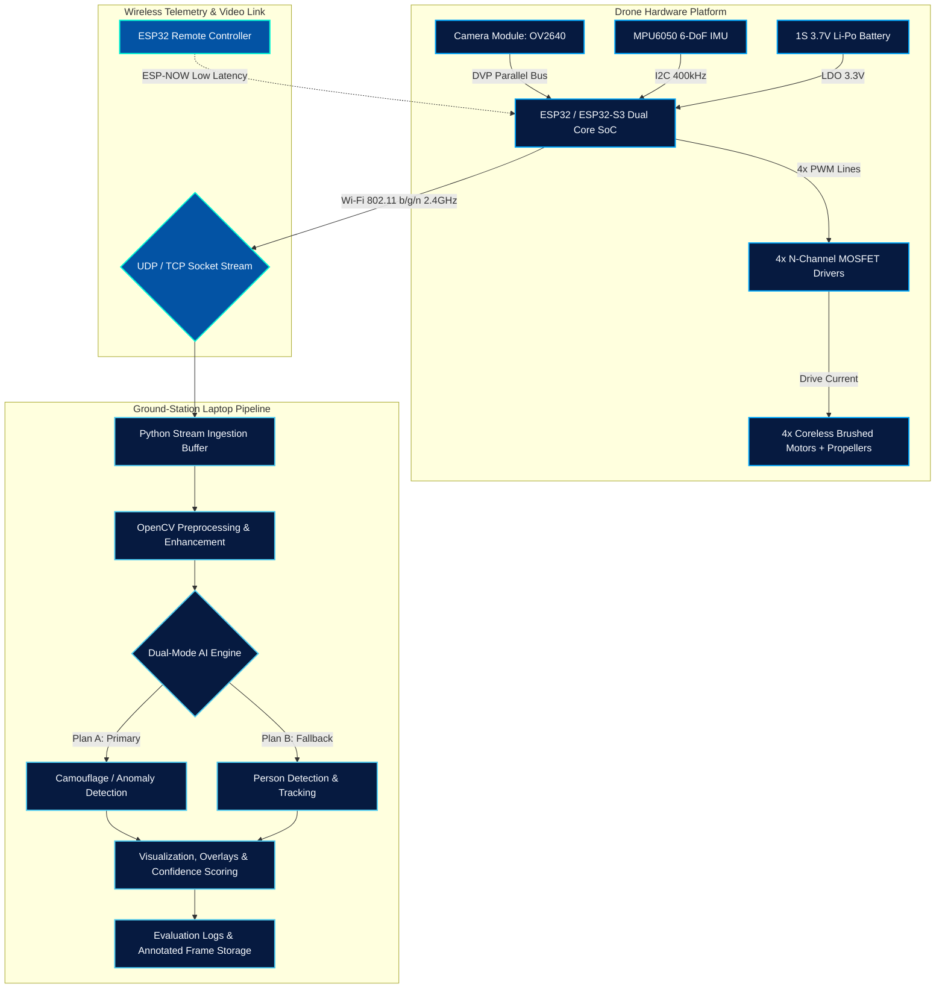
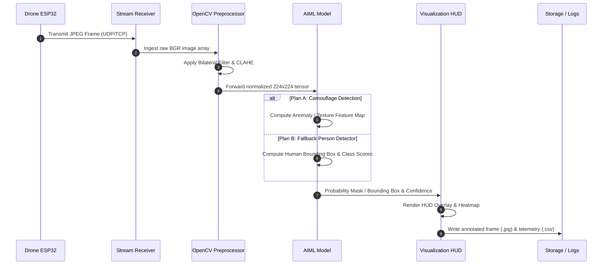

# SkyForge System Architecture Specification

## 1. Executive Architecture Summary

SkyForge couples an agile, ultra-compact ESP32-based aerial platform with a workstation-class ground-station image analysis pipeline. The design deliberately isolates real-time flight stabilization from computationally intensive computer-vision and AI inference workloads.

---

## 2. Onboard Drone Hardware Architecture

### 2.1 Microcontroller Core Partitioning
The ESP32 / ESP32-S3 dual-core microcontroller provides two distinct processing contexts:
- **Core 0 (Flight Stabilization & Safety):** Runs the deterministic 250 Hz flight-control loop. Handles MPU6050 sensor polling via I2C, complementary/Kalman orientation filtering, PID calculation (Roll, Pitch, Yaw), and PWM pulse generation for motor drivers.
- **Core 1 (Wireless Transmission & Imaging):** Operates the DMA-driven camera frame acquisition, JPEG compression buffering, and Wi-Fi transmission.

> [!IMPORTANT]
> **Deterministic Decoupling Rule:** Under no circumstances does Core 0 block or await responses from the vision pipeline. If Wi-Fi bandwidth degrades or the camera drops frames, flight stabilization maintains uninterrupted execution.

### 2.2 Propulsion & Motor Driving
- **Actuators:** 4× high-RPM coreless brushed motors (e.g., 716, 720, or 8520 depending on final weight calculations).
- **Drive Stages:** Discrete N-channel MOSFET switching stages (e.g., SI2302 or AO3400) protected with flyback Schottky diodes and gate pulldown resistors. Coreless motors must never be driven directly by microcontroller GPIO pins.
- **Propellers:** 2× Clockwise (CW) and 2× Counter-Clockwise (CCW) matched pairs to balance rotational torque.

### 2.3 Sensor Fusion & Power Architecture
- **Inertial Measurement Unit:** InvenSense MPU6050 3-axis accelerometer and 3-axis gyroscope interfaced over I2C Fast Mode (400 kHz).
- **Power System:** 1S 3.7V Li-Po battery (380–500 mAh, 25C+ discharge rating) paired with an ultra-low dropout (LDO) 3.3V voltage regulator (e.g., ME6211 or RT9193) and decoupling ceramic capacitors to filter motor electrical noise.

---

## 3. Ground-Station Software Architecture

The ground station executes on a workstation or laptop receiving frames over Wi-Fi:

### 3.1 Pipeline Stages
1. **Stream Ingestion (`vision/capture/`):** Asynchronous socket receiver buffering incoming frames in a thread-safe ring queue to prevent frame lag.
2. **Preprocessing (`vision/preprocessing/`):** Converts raw sensor frames, applies adaptive contrast enhancement (CLAHE), suppresses sensor noise via bilateral filtering, and extracts high-frequency edge gradients.
3. **Inference Engine (`vision/detection/` & `ml/models/`):** Evaluates anomaly masks and confidence metrics. In Plan A, flags camouflage discrepancies against terrain; in Plan B, provides robust bounding-box coordinates for human subjects.
4. **Telemetry & HUD (`vision/visualization/`):** Overlays targeting reticles, confidence numbers, and diagnostic metrics (latency, FPS, dropped frame percentage).

---

## 4. Optional Future Expansion: Companion Computer

For post-v1.0 iterations where onboard edge processing is required:
- A **Raspberry Pi Zero 2 W** (quad-core ARM Cortex-A53, 512 MB RAM) can be mounted as a dedicated vision companion computer.
- It interfaces with the camera directly via CSI and communicates high-level telemetry and navigation cues back to the ESP32 flight controller over a high-speed UART serial bus (e.g., 921,600 baud), maintaining the core safety rule that the ESP32 remains the authoritative real-time flight manager.
