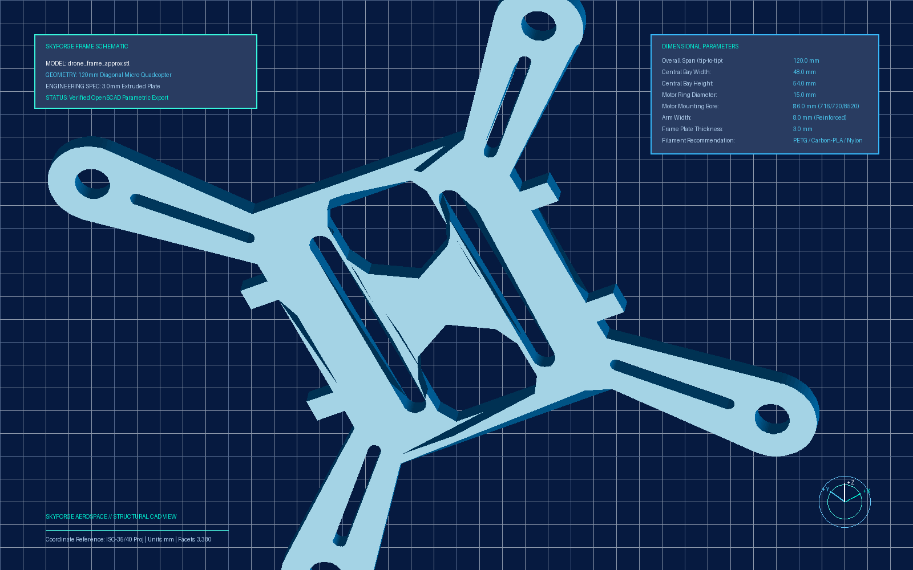

# SkyForge Hardware Setup & Assembly Guide

## 1. System Bill of Materials (BOM)

The following component schedule details the hardware required for the prototype. Components marked with an asterisk (*) are subject to iterative matching based on thrust-to-weight calculations.

| Item | Component | Qty | Interface | Purpose | Status |
|:---:|:---|:---:|:---:|:---|:---:|
| 1 | ESP32 / ESP32-S3 Development Board | 1 | Micro-USB / GPIO | Main flight controller & wireless streamer | Selected |
| 2 | MPU6050 6-DoF Sensor Module | 1 | I2C (SDA/SCL) | Tri-axial gyro & accelerometer stabilization | Selected |
| 3 | Coreless Brushed Motors (716/720/8520)* | 4 | PWM / High Current | Propulsion generation (2x CW, 2x CCW) | Sizing in progress |
| 4 | Matched Propellers (55–65mm)* | 4 | Press-fit | Lift generation (2x CW, 2x CCW) | Sizing in progress |
| 5 | N-Channel MOSFET Drivers (SI2302 / AO3400) | 4 | PWM Gate | Motor high-current low-side switching | Specified |
| 6 | Compact Camera Module (OV2640 / DVP) | 1 | DVP 8-bit | Aerial image acquisition | Evaluation underway |
| 7 | 3D-Printed Micro-Quadcopter Frame | 1 | Mechanical | Structural chassis (120mm span) | Model ready |
| 8 | 1S Li-Po Battery (3.7V 380–500mAh 25C)* | 1–2 | JST / Molex | Onboard power supply | Sizing in progress |
| 9 | Ultra-Low Dropout 3.3V Regulator (RT9193) | 1 | Power Rail | Clean voltage supply for logic & camera | Specified |
| 10 | Secondary ESP32 Module | 1 | USB / GPIO | Ground remote controller transmitter | Selected |
| 11 | 2-Axis Analog Joysticks | 2 | Analog ADC | Throttle/Yaw, Pitch/Roll pilot inputs | Selected |
| 12 | Status Indicator LEDs & Passive Buzzer | 2–4 | GPIO | Arming, battery alert, Wi-Fi status | Specified |

> [!WARNING]
> **Component Co-dependency Notice:** Motor size, propeller pitch/diameter, battery capacity/discharge rating, and MOSFET switching limits are intimately coupled. Final component orders should only be finalized once frame weight is verified.

---

## 2. 3D Frame Fabrication & Specification

The structural airframe is defined by the OpenSCAD parametric model located at `hardware/frame/drone_frame_approx.scad` and exported as `hardware/frame/drone_frame_approx.stl`.

<div align="center">
  
</div>

### Fabrication Guidelines
- **Nominal Tip-to-Tip Diagonal Span:** 120.0 mm
- **Plate Thickness:** 3.0 mm
- **Central Electronics Bay:** 48.0 mm × 54.0 mm
- **Motor Pod Diameter:** 15.0 mm outer, Ø 6.0 mm inner bore (adaptable to motor sleeve)
- **Recommended Filaments:**
  - **PETG:** Recommended baseline (excellent impact toughness, layer adhesion, and flexibility under minor vibration).
  - **Carbon-Fiber Infused PLA:** High stiffness and low deflection, recommended if frame resonance interferes with IMU.
- **Slicer Configuration:**
  - 100% infill or 4+ perimeters to ensure rigid arm transfer.
  - Print flat on bed without supports.

---

## 3. Electrical Wiring & Circuit Interconnects

```
ESP32 Controller Pinout:
---------------------------------------------
GPIO 21 (SDA) -------- MPU6050 SDA (I2C Data)
GPIO 22 (SCL) -------- MPU6050 SCL (I2C Clock)
GPIO 25 (PWM1) ------- Motor 1 (Front-Left CW) Gate
GPIO 26 (PWM2) ------- Motor 2 (Front-Right CCW) Gate
GPIO 27 (PWM3) ------- Motor 3 (Rear-Right CW) Gate
GPIO 14 (PWM4) ------- Motor 4 (Rear-Left CCW) Gate
GPIO 32 (ADC)  ------- Battery Voltage Divider
GPIO 33 (LED)  ------- Flight Status LED
```

### Motor Driver Stage Protection
Each of the 4 motor channels must include:
1. **Gate Pulldown Resistor (10kΩ):** Tied from ESP32 GPIO to GND to prevent unintended motor firing during bootloader initialization.
2. **Flyback Schottky Diode (e.g., 1N5819 or SS14):** Tied in parallel across motor terminals (cathode to +3.7V, anode to MOSFET drain) to absorb inductive back-EMF spikes.
3. **Decoupling Capacitors:** 100µF low-ESR electrolytic capacitor directly across the primary battery rail, plus 0.1µF ceramic capacitors near the ESP32 and MPU6050 power pins.

---

## 4. Bench Testing & Pre-Flight Validation

> [!CAUTION]
> **Propeller Safety Rule:** Never install propellers during electrical assembly, firmware flashing, or motor spin tests. All preliminary sensor calibration and motor direction checks must be executed with naked motor shafts.

1. **Continuity & Short-Circuit Check:** Use a digital multimeter in continuity mode across +BATT and GND rails prior to battery connection.
2. **Logic Power Verification:** Confirm clean 3.3V at ESP32 and MPU6050 VCC pins using a regulated bench supply or USB power.
3. **Motor Direction Verification:** Power each motor briefly at 10% PWM and verify rotation direction:
   - Front-Left & Rear-Right: Clockwise (CW)
   - Front-Right & Rear-Left: Counter-Clockwise (CCW)
4. **IMU Orientation Check:** Open the serial monitor at 115,200 baud to ensure positive pitch/roll readouts align with drone mechanical tilt.
