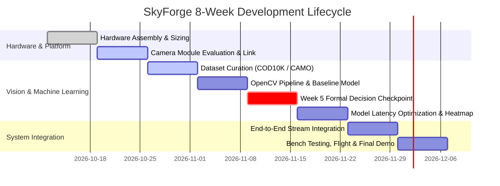
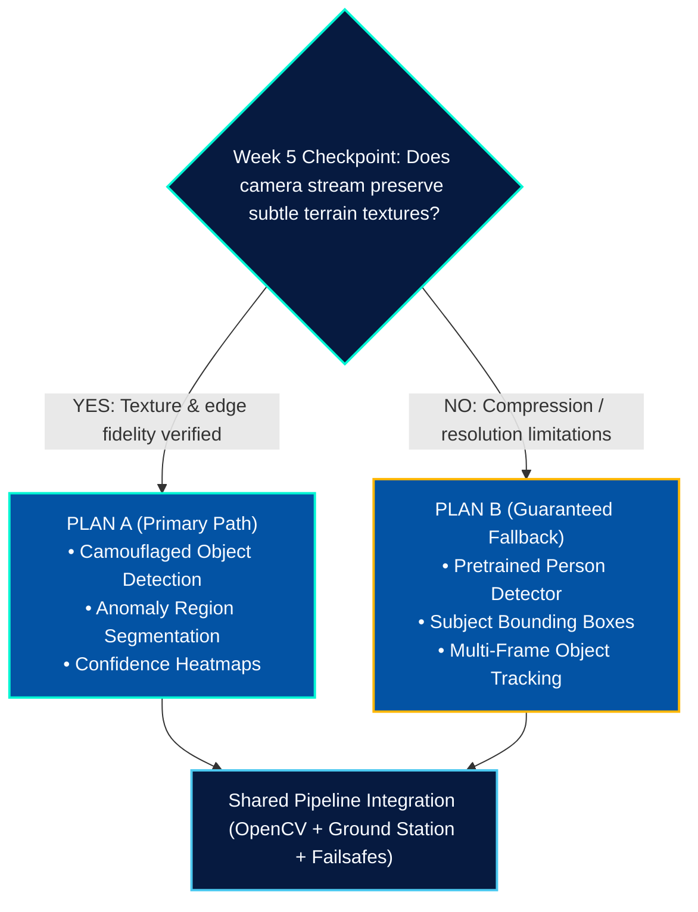

# SkyForge Development Roadmap & Milestone Schedule

This roadmap reflects the 8-week development schedule defined in the approved project synopsis for Team SkyForge (Team ID: 87, Department of Computer Science / AIML, GLA University).

---

## 1. Eight-Week Master Milestone Schedule

| Week | Phase / Milestone | Core Technical Deliverables | Primary Owner | Status |
|:---:|:---|:---|:---:|:---:|
| **1** | **Hardware Assembly** | Frame 3D printing, motor sizing, ESP32 power bench testing | Anirudh Kumar | Completed |
| **2** | **Camera Integration** | Camera module evaluation, DMA capture, Wi-Fi stream test | Priyanshu Kumar | In Progress |
| **3** | **Dataset Preparation** | COD10K/CAMO curation, self-captured terrain set, 70/15/15 splits | Arpit Dhaiya | In Progress |
| **4** | **Baseline AI Model** | Preprocessing (Bilateral + CLAHE), baseline segmentation / CNN | Pushkar Singhal | Planned |
| **5** | **Decision Checkpoint** | **Formal review: Evaluate camera texture fidelity. Elect Plan A or Plan B** | Team & Mentor | Milestone Gate |
| **6** | **Model Optimization** | Quantization, inference latency reduction ($\le$500 ms), heatmap output | Pushkar Singhal | Planned |
| **7** | **Drone Integration** | Wireless telemetry link coupling, bench verification, tethered trials | Anirudh Kumar | Planned |
| **8** | **Evaluation & Demo** | Comprehensive metric validation, demonstration, final academic report | Arpit Dhaiya | Planned |

---

## 2. Week 5 Formal Decision Checkpoint (Plan A vs. Plan B)

Camouflage detection relies upon subtle high-frequency texture contrasts and edge boundaries. Lightweight micro-cameras constrained by tiny drone payload capacities often introduce compression artifacts or lower resolution.

To safeguard project delivery, a formal milestone checkpoint occurs at the conclusion of Week 5:

### Checkpoint Evaluation Criteria
1. **Resolution & Sharpness:** Can the sensor resolve fine grass, pebble, and fabric textures at 1–2 meter altitudes?
2. **Streaming Frame Rate:** Does the Wi-Fi link sustain at least 5 FPS at QVGA resolution without excessive dropped frames ($< 10\%$)?
3. **Model Convergence:** Does the baseline model demonstrate an IoU $\ge 0.40$ on the preliminary validation split?

If these criteria are met, development proceeds along **Plan A**. If hardware sensor noise impedes camouflage discrimination, the project activates **Plan B (Person Detection & Tracking)**, which exercises the identical capture link, wireless ingestion, OpenCV filtering, and visualization architecture.

---

## 3. Project Status Breakdown

### Implemented
- [x] Parametric OpenSCAD 3D airframe (`hardware/frame/drone_frame_approx.scad`).
- [x] Sliced and validated STL model (`hardware/frame/drone_frame_approx.stl`).
- [x] System architecture design decoupling flight stabilization from vision workloads.
- [x] Python stream receiver, OpenCV preprocessing pipeline, and visualization modules.
- [x] Unit test framework and benchmarking scripts.

### In Progress
- [ ] Camera sensor module bench evaluation with ESP32-S3.
- [ ] Electrical driver PCB / perfboard prototyping (MOSFET stages + flyback diodes).
- [ ] Public dataset curation (COD10K and CAMO subsets).

### Planned
- [ ] Model training, loss function tuning, and IoU metric evaluation.
- [ ] Ground-station telemetry HUD integration.
- [ ] Controlled indoor tethered hover and flight testing.

### Future Scope (Post-v1.0)
- Onboard edge inference using a Raspberry Pi Zero 2 W companion computer via high-speed UART.
- Downward-facing optical flow sensor for autonomous altitude and position hold.
- Multi-spectral / thermal micro-sensor integration for all-weather camouflage penetration.
