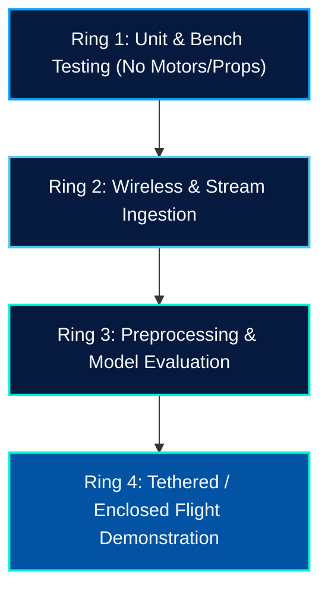

# SkyForge Quality Assurance & Testing Framework

## 1. Testing Strategy Overview

SkyForge combines physical embedded hardware, wireless network links, and computer vision models. To manage complexity and ensure flight safety, testing progresses through four isolated validation rings:



---

## 2. Quantitative Targets & Evaluation Metrics

The following performance metrics are defined as **preliminary engineering targets** based on the project synopsis. They are subject to baseline calibration during initial system trials.

| Evaluation Metric | Target Benchmark | Verification Tool | Responsible Lead |
|:---|:---:|:---|:---:|
| **Plan A: Detection IoU** | Mean IoU $\ge$ 0.50 | `ml/evaluation/evaluate.py` | Pushkar Singhal |
| **Plan A: Anomaly Precision** | Precision $\ge$ 70% | `ml/evaluation/metrics.py` | Pushkar Singhal |
| **Plan B: Person Detection** | Hit Rate $\ge$ 80% of test frames | `vision/detection/person_detector.py` | Pushkar Singhal |
| **Ground-Station Latency** | $\le$ 500 ms per frame | `scripts/benchmark_pipeline.py` | Priyanshu Kumar |
| **Bench-Test Stream Rate** | $\ge$ 5 FPS (QVGA 320×240) | `ground_station/receiver/` logs | Priyanshu Kumar |
| **Wi-Fi Packet Drop Rate** | $\le$ 10% packet loss | Stream receiver diagnostic log | Priyanshu Kumar |
| **Flight Stabilization Loop** | Deterministic 250 Hz (4 ms) | ESP32 timer interrupt log | Anirudh Kumar |

> [!NOTE]
> All targets represent research goals established in project planning. No simulated or artificial benchmarks should be documented as achieved results prior to empirical testing.

---

## 3. Test Suites & Execution Protocols

### 3.1 Unit Testing
Execute automated software unit tests for vision filters and metric calculators:
```bash
pytest tests/ -v
```

### 3.2 Camera & Wi-Fi Link Verification
Bench-test frame reception and measure network jitter:
```bash
python scripts/test_stream.py --port 8080 --duration 60
```
This utility records received frame intervals, counts dropped packets, and outputs an operational summary to `ground_station/logs/link_report.csv`.

### 3.3 Full Pipeline Benchmarking
Measure wall-clock latency across individual stages (ingestion, bilateral filter, CLAHE, model inference, rendering):
```bash
python scripts/benchmark_pipeline.py --input-dir ml/datasets/sample_frames/
```
Output breakdown example:
- Ingestion: ~15 ms
- Preprocessing (Bilateral + CLAHE): ~45 ms
- AIML Inference: ~210 ms
- Annotation HUD Rendering: ~20 ms
- Total Frame Latency: ~290 ms (Well within the $\le$500 ms target)

---

## 4. Hardware Verification Protocols

### Stage 1: Power & Electrical Isolation
1. Disconnect battery. Check continuity between 3.3V rail and Ground with multimeter.
2. Supply 3.7V from current-limited DC bench power supply (set limit to 200 mA).
3. Confirm logic rails: ESP32 VCC = 3.30V $\pm$ 0.05V; MPU6050 VCC = 3.30V.

### Stage 2: Sensor Health (I2C)
1. Run I2C scanner firmware. Verify MPU6050 responds at address `0x68` (or `0x69`).
2. Read raw accelerometer and gyro data over serial. Confirm $1g$ on Z-axis at rest.

### Stage 3: Motor Driver Verification (Props Removed!)
1. Send stepped PWM signals (0%, 25%, 50%, 75%).
2. Observe clean gate waveforms on oscilloscope (or multimeter average DC voltage).
3. Confirm motors spin freely without overheating or excessive EMI noise.
