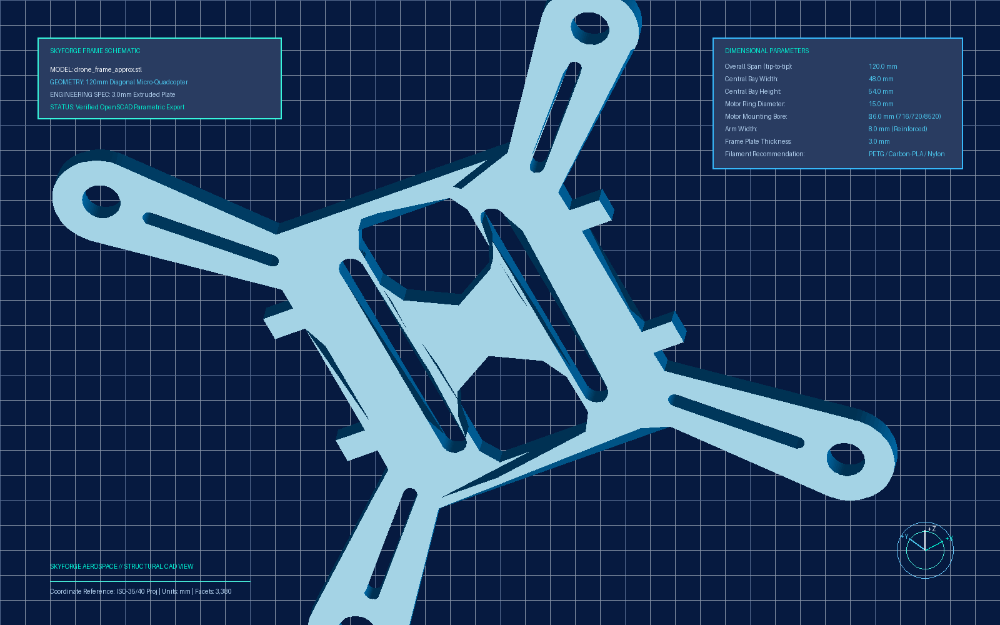

# SkyForge 3D Drone Frame Architecture

This directory contains the authoritative CAD source files for the SkyForge micro-quadcopter airframe.

  

---

## 1. Frame Geometry & Mechanical Parameters

The airframe is an ultra-lightweight symmetrical 'X' quadcopter configuration featuring reinforced diagonal arms, circular motor pods, and an elongated central payload bay.

- **Source File:** [`drone_frame_approx.scad`](drone_frame_approx.scad) (Parametric OpenSCAD design)
- **Exported Printable Model:** [`drone_frame_approx.stl`](drone_frame_approx.stl) (Standard 3D STL mesh)
- **Tip-to-Tip Diagonal Span:** 120.0 mm
- **Plate Thickness:** 3.0 mm extruded solid plate
- **Motor Pod Diameter:** 15.0 mm outer diameter
- **Motor Mounting Bore:** Ø 6.0 mm (accommodates standard brushed motor bushings or mounting screws)
- **Arm Width:** 8.0 mm reinforced root tapering with internal relief slots
- **Central Electronics Bay:** 48.0 mm × 54.0 mm with dual polygonal weight-reduction cutouts
- **Lateral Mounting Tabs:** 5.5 mm × 4.0 mm for sensor plates or camera mount brackets

---

## 2. 3D Printing Recommendations

| Parameter | Recommended Specification |
|:---|:---|
| **Material** | PETG (High impact resistance, flexibility, and fatigue life) or Carbon-PLA |
| **Layer Height** | 0.16 mm – 0.20 mm for optimal inter-layer tensile strength |
| **Infill Percentage** | 100% solid or minimum 4 perimeters |
| **Estimated Mass** | ~8.5 g – 11.5 g (depending on material density) |
| **Print Orientation** | Flat on print bed, zero supports required |

---

## 3. Direct File Access Links

- [Download OpenSCAD Source Model](drone_frame_approx.scad)
- [Download 3D-Printable STL Model](drone_frame_approx.stl)
